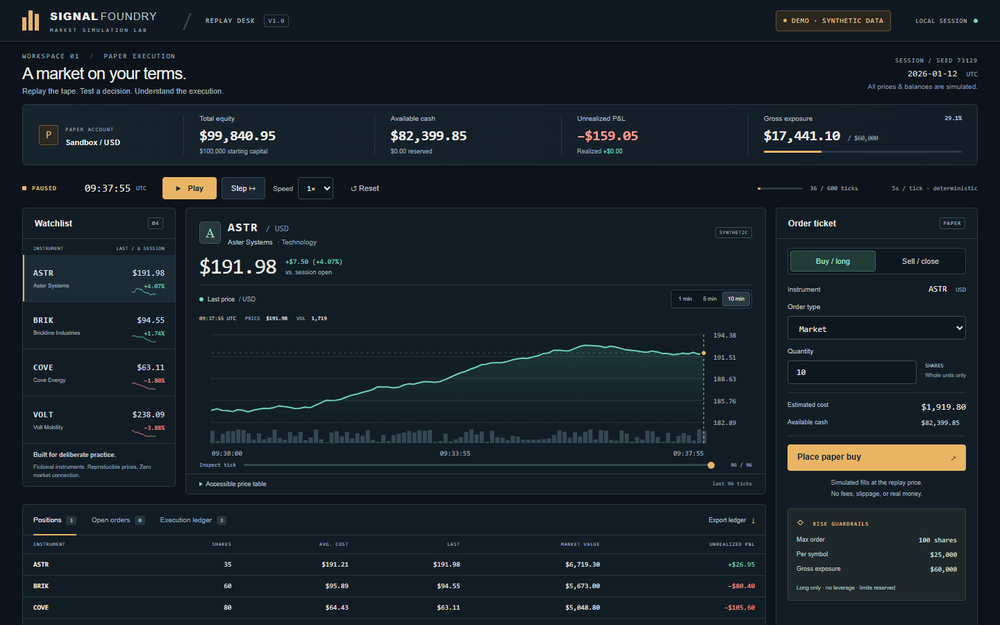
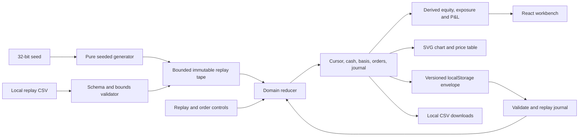

# Signal Foundry

**An offline market replay desk for practicing execution and explaining the math behind a trade.**

Signal Foundry generates a fictional market from a seed. Pause the tape, submit a paper order, and step forward to see how the fill changes cash, exposure, and profit or loss. The same seed and decisions produce the same result. Every instrument, price, timestamp, balance, and execution is synthetic.



[Full desktop capture](docs/screenshots/desktop.png) · [390px mobile capture](docs/screenshots/mobile.png) · [Actual local test results](docs/VERIFICATION.md)

## Try it in five minutes

Use an existing Node installation (Node 24 LTS recommended; locally verified with Node 25.1.0 and npm 11.6.2). From this directory:

```powershell
npm ci
npm run dev -- --port 5173 --strictPort
```

Open **http://127.0.0.1:5173**. No environment file, account, API key, external font, or backend is needed. Dependency installation needs registry access; the loaded workbench runs offline. Keep the local server running to open or reload it. This is a static browser app, not an installable PWA with an offline navigation cache.

For a quick experiment:

1. Buy 10 ASTR shares with the replay paused. Step forward and watch unrealized P&L change.
2. Choose **Limit** and set a buy price below the current price. Open orders shows the reservation; cancel it to release the cash.
3. Import [the sample replay](docs/examples/replay.csv). Its prices move from $100 to $90 to $110. A 10-share buy limit at $95 fills at $90 on the next step. Sell four shares at $110 to realize $80; six shares retain $120 unrealized profit.
4. Export the replay or ledger, reload to restore the paused account, then use **Reset** to restore the tape and all account state.

The CSV section also accepts an unsigned 32-bit seed. **Load seed & reset** creates a fresh generated session; **Reset** keeps the current generated or imported tape.

## What makes the desk useful

- **Repeatable experiments:** Mulberry32 seeded price paths, canonical UTC timestamps, five-second market ticks, play/pause, 1×/2×/4×/8× playback, single-step execution, and deterministic reset.
- **Execution with constraints:** market and limit orders, immediate marketable limits, observed-price improvement, FIFO evaluation of pending orders, cancellation, cash/share reservations, and explicit rejection messages.
- **Accounting you can inspect:** integer-cent cash and cost basis, weighted purchase cost, realized and unrealized P&L, equity, gross exposure, and an order ledger with distinct submission and fill times.
- **A focused interface:** four fictional instruments, pointer and keyboard chart inspection, 1/5/10-minute chart windows, volume, an accessible price table, keyboard tabs, visible focus, reduced-motion support, and a deliberately stacked mobile layout.
- **Honest imported timelines:** imported tapes use 12/60/120-tick chart windows, preserving their actual timestamp cadence rather than assuming five-second spacing.
- **Portable experiments:** strict replay CSV import/export, spreadsheet-safe ledger export, and versioned local persistence reconstructed from validated actions.

## Architecture and data flow



| File                          | Responsibility                                                      |
| ----------------------------- | ------------------------------------------------------------------- |
| `src/domain.ts`               | Generator, pure transitions, fills, risk checks, integer accounting |
| `src/csv.ts`                  | Exact replay schema, byte/row limits, formula-safe ledger output    |
| `src/persistence.ts`          | Versioned envelope and account reconstruction                       |
| `src/App.tsx`                 | Desk controls, order entry, account views, local file operations    |
| `src/Chart.tsx`               | Bounded SVG window, pointer/keyboard inspection, table alternative  |
| `tests/domain.test.ts`        | Replay, accounting, validation and persistence invariants           |
| `tests/e2e/workbench.spec.ts` | Real browser workflows at desktop and mobile sizes                  |

React and ReactDOM are both pinned to **19.2.6**, mounted with `createRoot` from `react-dom/client`. The domain uses `useReducer`; loading is a lazy initializer. Account metrics are derived, not stored twice. Timers, storage listeners, and pending file reads have cleanup or invalidation. Charts render at most 120 points per symbol, plus 30-point watchlist traces. Order IDs and timestamp keys remain stable.

React documentation was checked using:

```text
npx --yes @aisuite/chub get react/react --version 19.2.6 --lang javascript
```

The implementation follows the documented [root API](https://react.dev/reference/react-dom/client/createRoot), [effect cleanup](https://react.dev/reference/react/useEffect), and [reducer initialization](https://react.dev/reference/react/useReducer).

## Execution and accounting assumptions

All money is integer USD cents. Orders use whole shares from 1 to 100. Decimal limit input is parsed into cents without floating-point multiplication; nonfinite numbers, exponent notation, negatives, and excess decimals are rejected. Positions retain total integer cost rather than a rounded average price. A partial sale removes `round(totalCost × soldShares / heldShares)` cents; the final sale removes the entire remaining basis. Displayed average cost is rounded to a cent. All bounded arithmetic remains inside JavaScript's safe integer range.

The account starts with **$100,000** and supports long positions only. Buy admissions include pending buys against a **$25,000 per-symbol cap** and **$60,000 gross cap**; outstanding cash and shares cannot be spent twice. Pending buys reserve `quantity × limit`; exposure checks conservatively use the greater of the limit and current price. Pending sells do not reduce risk until filled. Orders recheck constraints at execution and can be rejected if the account has changed.

Caps are admission controls. Price appreciation can carry existing holdings beyond a cap; there is no forced liquidation. Fills occur in submission order at the current synthetic last price when the limit is crossed. No spread, commission, slippage, partial fills, liquidity matching, leverage, shorts, dividends, tax treatment, or live-market fidelity is modeled. Synthetic volume is a chart attribute, not a fill constraint.

Generated sessions contain 660 frames: 60 historical context frames and 600 playable ticks. The account starts at frame 59 with no trades in the context period. Imported sessions start at their first timestamp. Playback advances one market tick every `1000 / speed` wall-clock milliseconds; browser throttling can slow playback without altering replay timestamps. Sessions stop accepting new orders at 200 accepted orders; export and reset to begin another run. Invalid submissions leave the account unchanged and show an error; they are not added to the ledger.

## CSV and local persistence

Replay import requires the exact, unquoted header:

```csv
timestamp,symbol,price_cents,volume
```

Files are limited to **512 KiB**, **4,000 data rows / 1,000 frames**, and at least two complete frames. Every timestamp needs ASTR, BRIK, COVE, VOLT in that order. Timestamps must be canonical `YYYY-MM-DDTHH:mm:ss.sssZ`, within 2020–2099, strictly increasing between groups. The parser rejects duplicate symbol/timestamp pairs, incomplete groups, invalid dates, unknown symbols, blank rows, extra fields, quoted fields, formulas, nonfinite values, fractional values, and exponents. Price cents must be 1–1,000,000; volume must be 0–1,000,000. A UTF-8 BOM, CRLF line endings, and one trailing newline are supported. Errors identify the row and rule. The whole file is validated before replacing the account.

Replay export uses that same schema. Ledger export is a read-only report with this header:

```csv
id,timestamp,symbol,side,type,quantity,limit_cents,status,fill_cents,filled_at,reason
```

Ledger cells are quoted and escaped; formula prefixes (`=`, `+`, `-`, `@`, including after whitespace) are neutralized with an apostrophe. Replay output contains only validated canonical identifiers and unsigned numbers. Imports never execute code. Ledger import is deliberately unsupported because an arbitrary execution report is insufficient to reconstruct a valid account.

Only this app's `signal-foundry.session.v1` localStorage key is used. It stores the seed or validated imported tape, cursor, and bounded action journal—not trusted account totals. Restoration rebuilds the account through the same reducer and always pauses playback. Unsupported versions, oversized envelopes, malformed JSON, bad tapes, and impossible actions recover to a clean session with a visible message. Writes are debounced by 100 ms and flushed on `pagehide`; browser crashes within that window can lose the latest action. Storage failure leaves a usable in-memory desk with an export reminder. Reset replaces the saved account. Separate tabs use last-writer-wins storage; use one desk tab per experiment. Nothing is uploaded.

## Verify locally

```powershell
npm test
npm run lint
npm run typecheck
npm run build
npm run test:e2e
```

The browser suite defaults to an existing Google Chrome installation and runs one worker at **1440×900** and **390×844**. It captures real screenshots in `docs/screenshots`. Where Chrome is unavailable, a previously installed Playwright Chromium can be selected in PowerShell with `$env:PLAYWRIGHT_CHANNEL = 'chromium'`; installing a browser is not needed on the verified laptop. The suite uses port 5173, starting the local server if it is not running.

Tests exercise deterministic generation, cash/basis/P&L identities, partial sales, limit crossings, reservations and cancellation, all three risk limits, invalid numbers, complete reset, malformed/oversized/formula CSV paths, journal validation, storage failure, reload persistence, keyboard access, and viewport overflow. Browser interactions also run after the context is made offline. [The verification record](docs/VERIFICATION.md) reports the actual completed runs and their limits.

The production build is plain static output. To inspect it locally:

```powershell
npm run preview -- --port 4173 --strictPort
```

GitHub Actions runs the same checks with one browser worker and passed for the prior verified commit `889809d78b8e91ee4d0dc08a9290c12fe7c1fa7f` ([successful run 38912207725](https://github.com/notfrostedwow/realtime-trading-dashboard/actions/runs/38912207725)). The [source is public](https://github.com/notfrostedwow/realtime-trading-dashboard); no hosted deployment is provided. An [optional AWS static-hosting design](docs/AWS-ARCHITECTURE.md) is documentation only.

## Design decisions

Ink and navy surfaces keep the price trace dominant; amber identifies deliberate actions, while signed teal/coral numbers describe gains and losses. Fine rules and tabular figures make comparisons easier without a wall of decorative cards. Fonts are offline system fallbacks: Arial/Helvetica for labels, Consolas/Courier New for numbers. Mobile preserves every action in a single column; wide data tables scroll inside their panels rather than pushing the viewport sideways.

A custom SVG avoids a chart dependency and exposes the exact same bounded data through a summary and table. Keeping the execution model independent of React makes account invariants testable without a browser. Journal reconstruction trades a small bounded replay cost for stronger malformed-state recovery. There is no broker adapter, credential handling, telemetry, or network data source.

**Synthetic demonstration only. No real-market operation, real money, or trading advice.**

MIT © 2026 Zaheer Miah. See [LICENSE](LICENSE).
