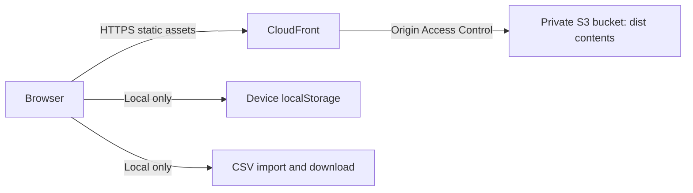

# Optional static-hosting design

Documentation only. No AWS account was accessed, no credentials were handled, and no infrastructure or spend was created. This project remains local and unpublished. Implementation would require separate authorization.

The proposed deployment serves only the compiled `dist/` directory. A private S3 bucket with Block Public Access would be a regular bucket origin, behind CloudFront Origin Access Control. The bucket policy would allow read access only for the designated distribution. The default CloudFront domain would avoid requiring a purchased custom domain. HTTP viewers would redirect to HTTPS; `index.html` would be the default root object.

This follows [AWS's documented OAC design](https://docs.aws.amazon.com/AmazonCloudFront/latest/DeveloperGuide/private-content-restricting-access-to-s3.html). An S3 website endpoint cannot use OAC, so it is not the proposed origin. No deployment commands, infrastructure provisioning files, account identifiers, or secrets are included.

Hashed assets could use long immutable cache lifetimes. `index.html` should have short or revalidation-based caching, so releases pick up the new hashed files. Previous build files should be retained briefly for rollback and open tabs. There are no path-based client routes requiring an error rewrite.

The browser still performs generation, replay, accounting, file validation, and persistence locally. Hosting does not introduce an execution API, account service, database, broker connection, remote journal, or token flow. A future deployment should define content-security and other response headers, privacy choices for access logs, retention limits, rollback, a small explicit cost budget, and teardown ownership before provisioning. This document makes no claim that hosted security headers, cloud monitoring, infrastructure tests, or cloud CI have been configured or run.
